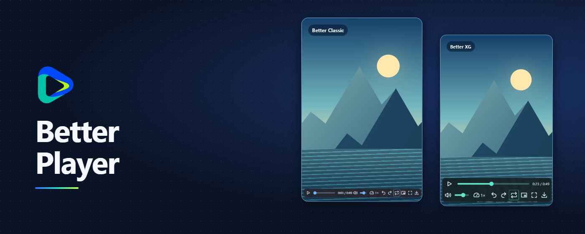
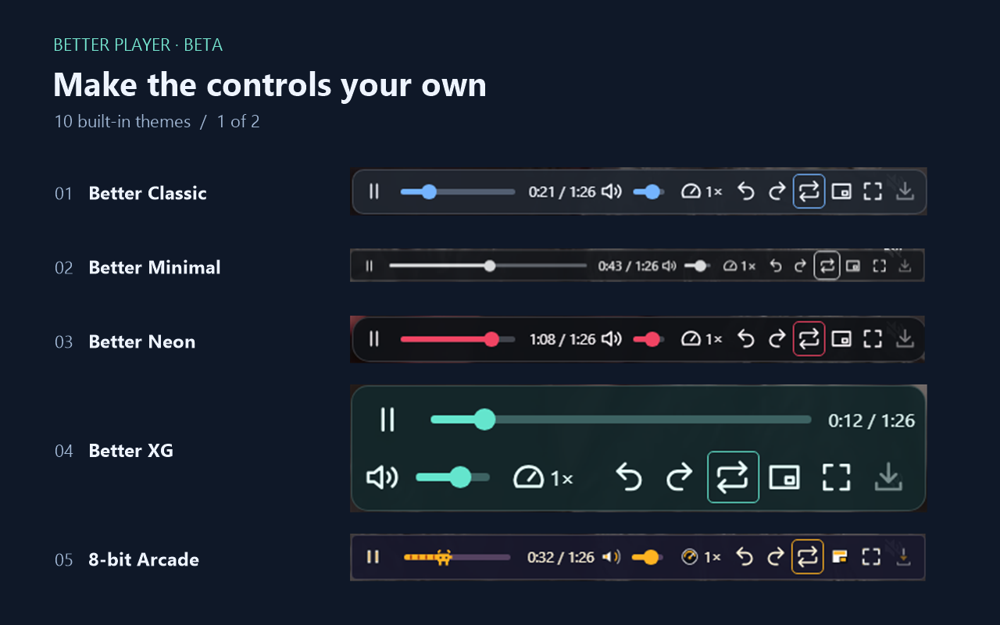
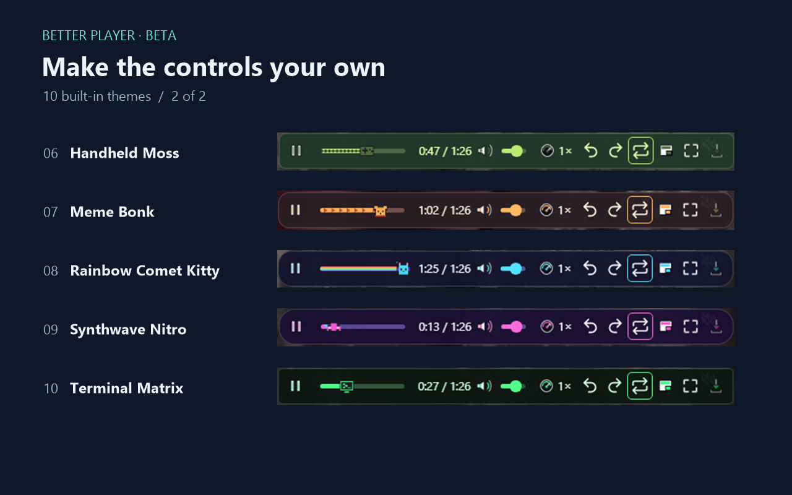

# Better Player

**[Português (Brasil)](./README.md) · [English](./languages/en/README.md) · [Other Languages](./languages/README.md)**

Ajuste a velocidade e o volume dos vídeos do Instagram, repita trechos e baixe vídeos compatíveis.

**[Instalar · Chrome Web Store](https://chromewebstore.google.com/detail/better-player/abapegnadkbbldnohmmbcklpicommlik)** · [Site](https://richardikeda.github.io/better-player-public/) · [GitHub Issues](https://github.com/richardikeda/better-player-public/issues) · [Privacidade](https://richardikeda.github.io/better-player-public/#privacidade)

## Recursos

- **Reprodução**. Controle velocidade, volume, posição e repetição A–B. Use tela cheia ou PiP quando disponível.
- **Personalização**. Escolha entre 10 temas e configure o tempo de exibição dos controles.
- **Salvamento opcional**. Baixe vídeos compatíveis ou grave trechos localmente, quando o navegador permitir.

## Temas

 

## Onde instalar

Chrome, Edge e os demais navegadores abaixo oferecem instalação pela loja. O Better Player foi testado em Chrome e Edge no Windows.

[Chrome](https://support.google.com/chrome/answer/2664769) · [ChromeOS](https://support.google.com/chromebook/answer/2588006) · [Edge](https://support.microsoft.com/en-us/edge/add-turn-off-or-remove-extensions-in-microsoft-edge) · [Brave](https://support.brave.app/hc/en-us/articles/360017909112-How-can-I-add-extensions-to-Brave) · [Vivaldi](https://help.vivaldi.com/desktop/appearance-customization/extensions/) · [Opera](https://help.opera.com/en/faq/) · [Yandex Browser](https://yandex.com/support/browser/en/personalization/extension) · [Dia](https://resources.arc.net/hc/en-us/articles/44413577819159-Arc-Sunset-Frequently-Asked-Questions)

**Android.** Vivaldi e Yandex Browser documentam instalação pela loja no Android. A extensão ainda precisa de validação nesses navegadores móveis. No Vivaldi, use a opção Site para computador. [Vivaldi](https://help.vivaldi.com/android/android-tools/extensions-on-android/) · [Yandex Browser](https://yandex.com/support/browser-mobile-android-phone/en/personal-settings/extensions)

Firefox e Safari usam canais próprios. A edição do Firefox está em testes.

## Suporte

Abra o Instagram no navegador após instalar. Clique no ícone do Better Player para configurar os controles. Se precisar de ajuda, informe o navegador, a versão e os passos para reproduzir o problema.

[GitHub Issues](https://github.com/richardikeda/better-player-public/issues)
